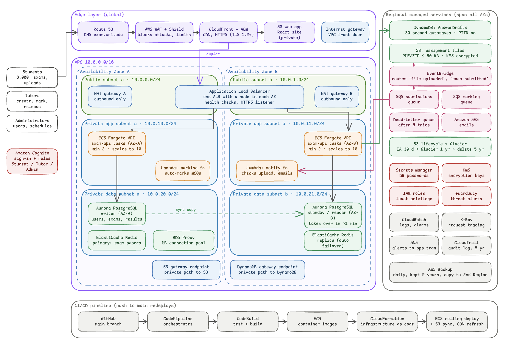
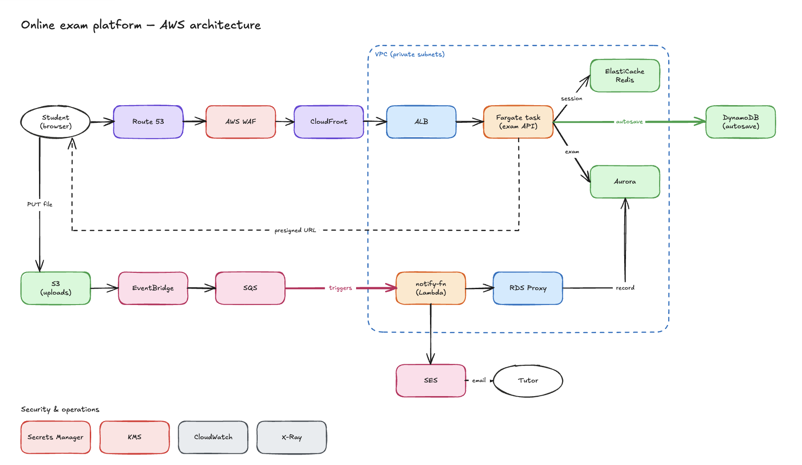

# Online Exam and Assignment Platform on AWS

A cloud design for a university with **8,000 students and about 400 staff** that is moving all exams and assignment submissions online.

### Flow 1 (open exam, autosave): Student → Route 53 → WAF → CloudFront → ALB → Fargate task → Redis/Aurora (exam) and DynamoDB (autosave).

### Flow 2 (upload): API returns a presigned URL → browser uploads straight to S3 → EventBridge → SQS → notify-fn → Aurora (via RDS Proxy) + SES email to tutor.

### Colours: purple = edge · blue = network · orange = compute · green = data · pink = messaging · red = security · grey = operations. Green arrow = autosave; pink arrow = queue triggers notify-fn.

## What the platform does

| Who | What they do |
|---|---|
| Students | Sign in, sit timed exams (multiple choice and short answer), upload assignments (PDF or ZIP, up to 50 MB) |
| Tutors | Create exams, mark answers, release results |
| Administrators | Manage users and exam schedules |

Main features:
- Sign-in with a different role for students, tutors and administrators
- Answers saved automatically every 30 seconds
- Multiple-choice questions marked automatically
- An email goes out when results are released or an assignment arrives

## The targets the design must meet

| Target | How the design meets it |
|---|---|
| 300–500 users normally; **3,000 students starting an exam within 5 minutes** | Extra servers are added before each exam and more are added automatically when load rises; busy data is cached; background work goes through queues |
| **99.9% available** during exams | Every part runs in two separate data centres (Availability Zones) |
| **Keeps working if one Availability Zone fails** | The load balancer moves traffic to the healthy zone and the database switches to its copy in about a minute |
| **Lose at most 5 minutes of answers** (RPO) | Autosaves and the database can be restored to any point in time; the browser keeps a local copy too |
| **Back online within 1 hour** (RTO) | Automatic switch-over takes minutes; a full restore from backup takes well under an hour |
| **Keep records for 5 years** | AWS Backup and S3 storage rules keep data for 5 years, then delete it |
| **Encrypted in transit and at rest** | HTTPS (TLS 1.2 or newer) everywhere; all stored data encrypted with AWS KMS keys |

## The design in one paragraph

Students reach the site through **Route 53** (the address book), **AWS WAF** (a security filter) and **CloudFront** (a fast delivery network). The web pages come from a private **S3** bucket. API requests go to an **Application Load Balancer**, which shares them between **ECS Fargate** containers running in two Availability Zones. **Cognito** handles sign-in and roles. Exam data lives in **Aurora PostgreSQL** (with a standby copy in the second zone), autosaved answers in **DynamoDB**, and popular exam papers in **ElastiCache Redis**. Files upload straight to **S3** using a short-lived link. When a file arrives, **EventBridge** and **SQS** pass the job to a **Lambda** function, which records it and emails the tutor through **SES**. **CloudWatch**, **X-Ray**, **CloudTrail** and **GuardDuty** watch the system. **Secrets Manager** and **KMS** protect passwords and data. A **CodePipeline** rebuilds and redeploys the system every time code is pushed to the main branch.

## What is in this repository

| Folder or file | What it contains |
|---|---|
| [`architecture/README.md`](architecture/README.md) | The diagram explained layer by layer |
| [`architecture/architecture-diagram.png`](architecture/architecture-diagram.png) | The full architecture diagram (also as `.svg`) |
| [`architecture/walkthroughs.md`](architecture/walkthroughs.md) | Two step-by-step request walkthroughs |
| [`architecture/peak-and-az-failure.md`](architecture/peak-and-az-failure.md) | How the design handles the exam peak and the loss of one Availability Zone (under 300 words) |
| [`docs/services.md`](docs/services.md) | Every AWS service: its job, why it was chosen over another option, its settings, and what it connects to |
| [`docs/glossary.md`](docs/glossary.md) | Plain-English meanings of the technical terms |
| [`evidence/`](evidence/README.md) | Cloud Architecture Lab results: saved canvases (JSON) and images (PNG) for each simulation |

## Deploy steps

The whole system is described as infrastructure as code (AWS CloudFormation), so it is created the same way every time.

1. **Prepare the account.** Choose one AWS Region with at least two Availability Zones. Register or point the domain (for example `exam.uni.edu`) in Route 53. Verify the university email domain in Amazon SES and request production sending access.
2. **Create the certificates.** Request HTTPS certificates in AWS Certificate Manager: one in `us-east-1` for CloudFront and one in your Region for the load balancer.
3. **Connect the code.** Link the GitHub repository to AWS through an AWS CodeConnections connection.
4. **Deploy the pipeline stack once.** This creates CodePipeline, CodeBuild and the ECR image store.
5. **Let the pipeline build everything else.** The pipeline deploys the stacks in this order:
   1. **Network:** VPC, six subnets across two zones, internet gateway, two NAT gateways, gateway endpoints, security groups
   2. **Data:** Aurora cluster, RDS Proxy, ElastiCache, DynamoDB table, S3 buckets with lifecycle rules, KMS keys, secrets, backup plan
   3. **Application:** load balancer, ECS Fargate service with auto scaling, Lambda functions, EventBridge rules, SQS queues
   4. **Edge:** CloudFront, WAF, Route 53 records, Cognito user pool with Student, Tutor and Admin groups
   5. **Monitoring:** CloudWatch dashboards and alarms, SNS alert topic, CloudTrail, GuardDuty
6. **Check it works.** Open the site, sign in as a test student, start a test exam, upload a test PDF, and confirm the tutor email arrives.
7. **From now on:** every push to the `main` branch runs tests, builds a new container image, applies any infrastructure change and rolls the new version out with no downtime.

Before each exam week, an administrator sets a scheduled scale-out so extra servers are already running 30 minutes before the exam starts.

## Tear-down steps

Do this to remove everything and stop all charges, for example after testing.

1. **Keep what you must keep.** Export any results you need. The AWS Backup vault is locked for 5 years on purpose, so real exam records cannot be deleted early.
2. **Empty the S3 buckets** (web app and assignment files). CloudFormation cannot delete a bucket that still holds files.
3. **Delete the stacks in reverse order:** monitoring → edge → application → data → network → pipeline.
4. **Database:** the data stack takes a final Aurora snapshot before deleting the cluster. Delete that snapshot too if it is not needed.
5. **Check the leftovers.** Look for CloudWatch log groups, ECR images, KMS keys (these wait 7–30 days before deletion) and the Route 53 hosted zone. Delete what is no longer needed.
6. **Check the bill.** Look at AWS Cost Explorer the next day to confirm nothing is still running.

## Simulation results

The full design was built and tested in the Cloud Architecture Lab. All seven tests passed. Details and files are in [`evidence/`](evidence/README.md).

| Test | Result |
|---|---|
| Student opens an exam (10× traffic spike) | ✅ HTTP 200, 185 ms |
| Answers autosave (100 requests per second) | ✅ HTTP 200, 183 ms |
| Student asks for an upload link | ✅ HTTP 200, 185 ms |
| 40 MB upload → S3 → EventBridge → SQS → Lambda | ✅ HTTP 202 (accepted for background work) |
| Lambda records the submission through RDS Proxy | ✅ HTTP 200 |
| Availability Zone A fails, student opens exam | ✅ HTTP 200: traffic moved to Zone B, database switched over |
| Availability Zone A fails, answers autosave | ✅ HTTP 200: traffic moved to Zone B |
