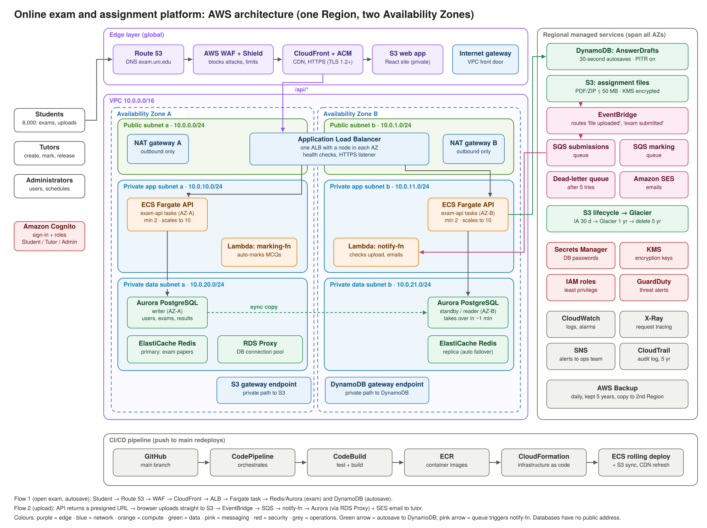

# Architecture

*Editable vector version: [`architecture-diagram.svg`](architecture-diagram.svg)*

The design is split into layers. Each layer has one job, and every layer that holds servers or data is copied across **two Availability Zones** (two separate data centres in the same AWS Region). If one zone fails, the other keeps running.

## 1. Users

- **Students** sit exams and upload assignments.
- **Tutors** create exams, mark answers and release results.
- **Administrators** manage users and exam schedules.

Everyone signs in through **Amazon Cognito**. Cognito puts each person in a group (Student, Tutor or Admin), and the API checks that group before every action. For example, only a Tutor can release results.

## 2. Edge layer (in front of everything)

| Part | What it does, simply |
|---|---|
| **Route 53** | Turns `exam.uni.edu` into the address of CloudFront |
| **AWS WAF + Shield** | Blocks attacks (SQL injection, scripting, floods) and limits how fast one address can try to log in |
| **CloudFront + ACM** | Serves the website from locations close to users, and forces HTTPS with a free, auto-renewing certificate |
| **S3 web app bucket** | Holds the website files (HTML, JavaScript). It is private, so only CloudFront can read it |

Requests for web pages stop here and never reach the servers. Only requests starting with `/api/` go on into the VPC.

## 3. Network (the VPC)

The VPC is a private network, `10.0.0.0/16`, with **six subnets**, three in each Availability Zone:

| Subnet | Zone A | Zone B | What lives there | Reachable from the internet? |
|---|---|---|---|---|
| Public | 10.0.0.0/24 | 10.0.1.0/24 | Load balancer, NAT gateway | Yes, load balancer only |
| Private app | 10.0.10.0/24 | 10.0.11.0/24 | Fargate API tasks, Lambda functions | No |
| Private data | 10.0.20.0/24 | 10.0.21.0/24 | Aurora, ElastiCache, RDS Proxy | No |

- The **internet gateway** is the VPC's front door for the load balancer.
- Each zone has its own **NAT gateway**, so private servers can reach the internet (for updates) without being reachable from it. A failure in one zone does not cut off the other.
- **Gateway endpoints** for S3 and DynamoDB keep that traffic inside AWS. This is safer and cheaper than going through NAT.
- **Security groups** act as firewalls between layers. Only the load balancer may talk to the API, and only the API and RDS Proxy may talk to the databases.

## 4. Compute

| Part | What it does |
|---|---|
| **Application Load Balancer** | One load balancer with a node in each zone. It checks server health and only sends requests to healthy servers |
| **ECS on Fargate (exam-api)** | Runs the API in containers. At least 2 tasks per zone at all times, up to 20 in total during an exam peak. No servers to patch |
| **Lambda: marking-fn** | Marks multiple-choice answers automatically after a student submits |
| **Lambda: notify-fn** | Checks a new upload, records it and emails the tutor |

## 5. Data

| Part | What it stores | How it survives a zone failure |
|---|---|---|
| **Aurora PostgreSQL** | Users, exams, questions, submissions, results | The writer is in Zone A with a standby in Zone B. If Zone A fails, the standby takes over in about a minute |
| **RDS Proxy** | Stores nothing: it shares database connections so many Lambda runs don't overload Aurora | Runs across both zones |
| **DynamoDB (AnswerDrafts)** | Autosaved answers, every 30 seconds | Built into AWS across several zones; point-in-time restore is on |
| **ElastiCache Redis** | Copies of exam papers, so 3,000 students don't all hit the database | Primary in Zone A, replica in Zone B, automatic failover |
| **S3 (assignment files)** | Uploaded PDF and ZIP files | Built into AWS across several zones |

**Storage lifecycle rule for assignment files:** Standard storage → Standard-Infrequent Access after 30 days → Glacier after 1 year → deleted after 5 years.

## 6. Background processing (asynchronous)

Slow jobs are not done while the student waits. They are put in a queue and done in the background:

1. **EventBridge** receives events such as "file uploaded" or "exam submitted" and sends each one to the right queue.
2. **SQS submissions queue** feeds `notify-fn`, and the **SQS marking queue** feeds `marking-fn`.
3. If a job fails 5 times, it moves to the **dead-letter queue** and an alarm goes off, so nothing is lost silently.
4. **Amazon SES** sends the emails.

## 7. Security

- **IAM roles** give each part only the permissions it needs. For example, the API can write to DynamoDB but cannot delete the table.
- **Secrets Manager** holds the database password and changes it automatically every 30 days.
- **KMS** keys encrypt the databases, files, queues and backups.
- **GuardDuty** watches for suspicious activity.

## 8. Monitoring and backup

- **CloudWatch** collects logs and metrics, and raises alarms (for example on many errors, slow responses, or jobs stuck in a queue).
- **SNS** sends those alarms to the operations team.
- **X-Ray** traces each request so slow steps are easy to find.
- **CloudTrail** records every change made in the AWS account, kept for 5 years.
- **AWS Backup** takes daily backups of Aurora and DynamoDB, keeps them for 5 years in a locked vault, and copies them to a second Region.

## 9. CI/CD pipeline

`GitHub (main branch) → CodePipeline → CodeBuild (tests and build) → ECR (container images) → CloudFormation (infrastructure) → ECS rolling deploy (plus website upload to S3 and a CloudFront refresh)`

Pushing to `main` redeploys everything automatically, with no manual steps.

## More detail

- Step-by-step request flows: [`walkthroughs.md`](walkthroughs.md)
- Exam peak and zone failure: [`peak-and-az-failure.md`](peak-and-az-failure.md)
- Every service with its reasons and settings: [`../docs/services.md`](../docs/services.md)
