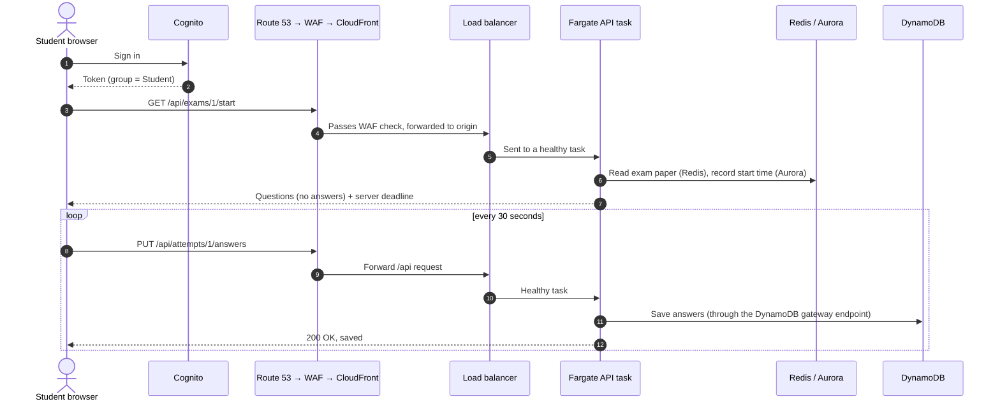
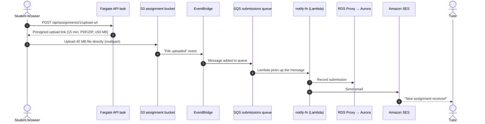

# Request walkthroughs

Two everyday actions, followed step by step through the architecture. Both were simulated in the Cloud Architecture Lab (see [`../evidence/`](../evidence/README.md)).

---

## Walkthrough 1: A student opens an exam and answers autosave

**In plain words:**

1. **Sign in.** The student signs in with Cognito and gets a token that says "this person is a Student".
2. **Find the site.** The browser asks Route 53 for `exam.uni.edu` and is sent to CloudFront.
3. **Security check.** AWS WAF inspects the request and blocks it if it looks like an attack or one address is sending too many requests.
4. **Website loads.** CloudFront serves the website files straight from its cache (from the private S3 bucket).
5. **Start the exam.** The page calls `GET /api/exams/1/start`. CloudFront forwards `/api/` requests to the **Application Load Balancer**.
6. **Pick a healthy server.** The load balancer sends the request to a healthy Fargate task in either zone.
7. **Check and load.** The task checks the token (is this a Student, enrolled in this exam, inside the exam window?). It reads the exam paper from **Redis** (or Aurora if Redis does not have it yet) and records the start time in **Aurora**.
8. **Answer.** The student gets the questions without the answer keys, plus a deadline set by the server. The deadline comes from the server, not the student's clock, so it cannot be cheated.
9. **Autosave every 30 seconds.** The browser sends `PUT /api/attempts/1/answers`. The task saves the answers into **DynamoDB** through the private gateway endpoint. Each save carries a version number, so an older save can never overwrite a newer one.
10. **Safety copy.** The browser also keeps a local copy. If a save fails (for example during a zone failure), it simply tries again.
11. **Submit.** When the student submits, or time runs out, the API sends an "exam submitted" event to **EventBridge**. EventBridge puts it on the **SQS marking queue**, and **marking-fn** marks the multiple-choice answers and stores the results in Aurora. Short answers wait for the tutor.

**Lab result:** HTTP 200 at a 10× traffic spike (185 ms) for opening the exam, and HTTP 200 at 100 requests per second (183 ms) for autosave.

---

## Walkthrough 2: A student uploads a 40 MB assignment and the tutor is notified

**In plain words:**

1. **Ask for an upload link.** The student clicks Upload, and the app calls `POST /api/assignments/1/upload-url`. This goes through the same path as walkthrough 1: Route 53 → WAF → CloudFront → load balancer → Fargate task.
2. **The API checks and signs.** The API checks that the student is enrolled and the deadline has not passed. It then creates a **presigned S3 link** that:
   - works for 15 minutes only
   - accepts only PDF or ZIP files
   - accepts files up to 50 MB
3. **Upload straight to S3.** The browser uploads the 40 MB file **directly to S3** in parts (multipart upload). The big file never passes through the load balancer or the API servers, so they stay fast for everyone else.
4. **Stored safely.** S3 encrypts the file with a KMS key and keeps every version.
5. **S3 announces the file.** S3 sends a "file uploaded" event to **EventBridge**.
6. **Into the queue.** EventBridge puts the event on the **SQS submissions queue**. The student sees "Uploaded" right away (HTTP 202 = accepted).
7. **Lambda picks it up.** **notify-fn** takes the message, checks the file type and size, and records the submission in **Aurora** through **RDS Proxy**. The database password comes from **Secrets Manager**.
8. **Email the tutor.** notify-fn emails the tutor through **Amazon SES**.
9. **If something fails,** SQS retries the job. After 5 failed tries the message moves to the **dead-letter queue** and a CloudWatch alarm tells the operations team.

**Lab result:** the upload path S3 → EventBridge → SQS → Lambda returned HTTP 202, and the Lambda → RDS Proxy → Aurora step returned HTTP 200. The SES email step is drawn in the lab but cannot be run there, because the lab does not simulate SES.
