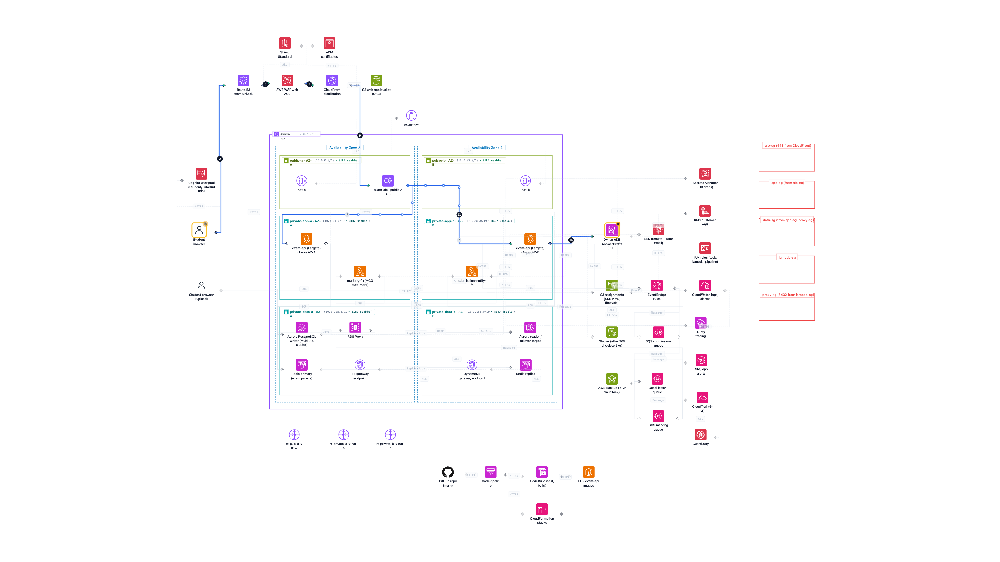
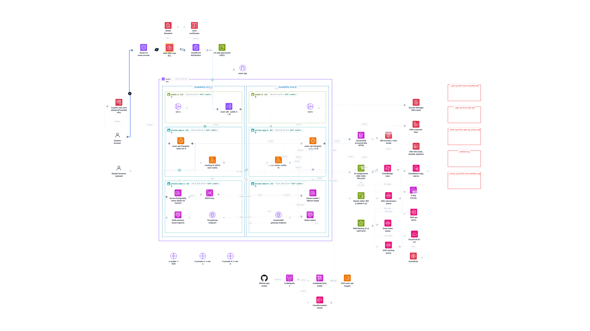
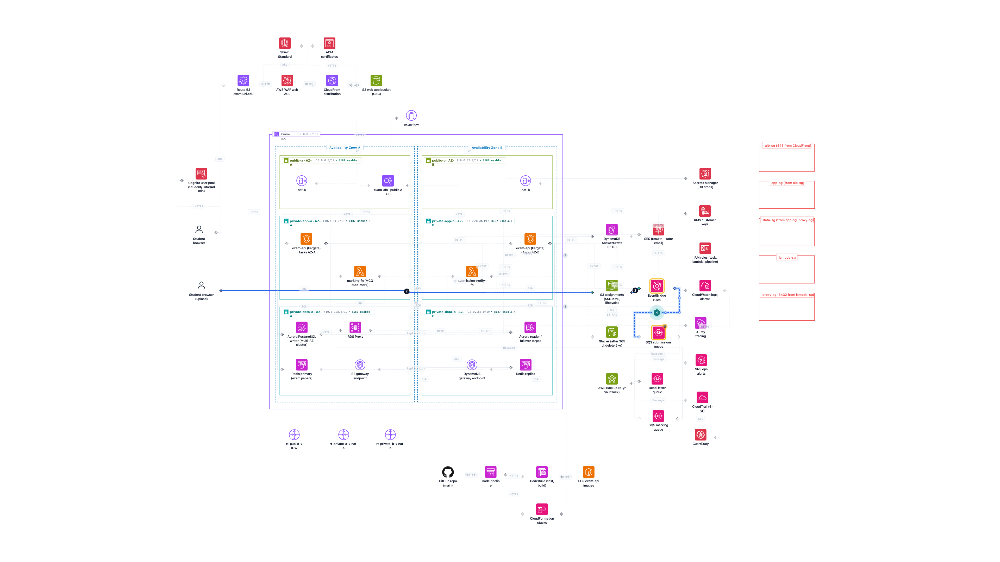
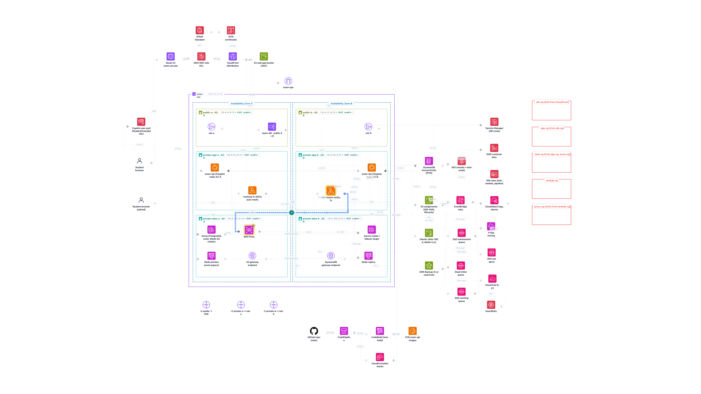
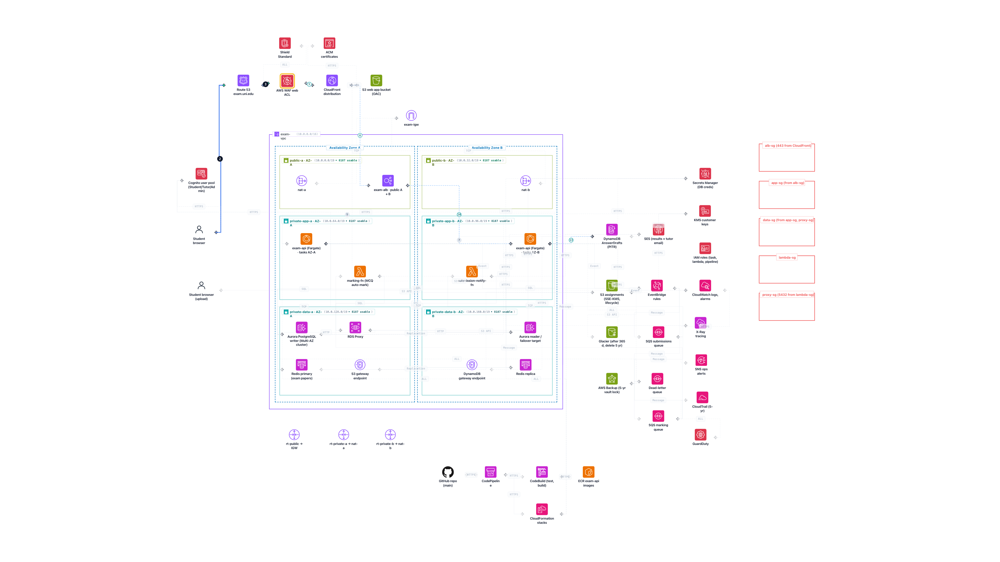

# Evidence: Cloud Architecture Lab

The full architecture was built in the [Cloud Architecture Lab](https://main.d35uam9e2t7o65.amplifyapp.com/#lab) and tested with both walkthroughs and an Availability Zone failure.

The lab has **no share links**. Each test is saved in two forms:
- a **workspace file** (`.json`) that reopens the exact canvas, request and failure state
- an **image** (`.png`) of the canvas

## How to reopen a test in the lab

1. Open the [Cloud Architecture Lab](https://main.d35uam9e2t7o65.amplifyapp.com/#lab).
2. Click **Export → Upload JSON** and choose one of the `.json` files below.
3. Click **Send Request** to replay the simulation, then **Trace** to see each decision.
4. For tests 06 and 07, open **Failure Lab** and click **AZ-A outage** before sending the request.

## The seven tests

| # | Files | Request | Load | Path taken | Result |
|---|---|---|---|---|---|
| 01 | [JSON](exam-platform-01-walkthrough1a-exam-start.json) · [PNG](exam-platform-01-walkthrough1a-exam-start.png) | `GET /api/exams/1/start` | 10× spike | Student → Route 53 → WAF → CloudFront → ALB → Fargate (AZ-A) → Aurora writer | ✅ HTTP 200, 185 ms |
| 02 | [JSON](exam-platform-02-walkthrough1b-autosave.json) · [PNG](exam-platform-02-walkthrough1b-autosave.png) | `PUT /api/attempts/1/answers` | 100 req/s | … → ALB → Fargate (AZ-A) → DynamoDB gateway endpoint → DynamoDB | ✅ HTTP 200, 183 ms |
| 03 | [JSON](exam-platform-03-walkthrough2a-upload-url.json) · [PNG](exam-platform-03-walkthrough2a-upload-url.png) | `POST /api/assignments/1/upload-url` | 10 req/s | … → ALB → Fargate (AZ-A) → Aurora writer | ✅ HTTP 200, 185 ms |
| 04 | [JSON](exam-platform-04-walkthrough2b-upload-s3-eventbridge-sqs-lambda.json) · [PNG](exam-platform-04-walkthrough2b-upload-s3-eventbridge-sqs-lambda.png) | `PUT /assignments/1/student-123/report.pdf` | 10 req/s | Student → S3 → EventBridge → SQS submissions → notify-fn | ✅ HTTP 202, 75 ms |
| 05 | [JSON](exam-platform-05-walkthrough2c-lambda-records-and-notifies.json) · [PNG](exam-platform-05-walkthrough2c-lambda-records-and-notifies.png) | `POST /internal/submissions` | 10 req/s | notify-fn → RDS Proxy (password from Secrets Manager) → Aurora writer | ✅ HTTP 200, 20 ms |
| 06 | [JSON](exam-platform-06-az-a-failure-exam-start.json) · [PNG](exam-platform-06-az-a-failure-exam-start.png) | `GET /api/exams/1/start` with **AZ-A down** | 10× spike | … → ALB skips failed AZ-A target → Fargate (AZ-B) → Aurora **fails over** to AZ-B | ✅ HTTP 200, 183 ms |
| 07 | [JSON](exam-platform-07-az-a-failure-autosave.json) · [PNG](exam-platform-07-az-a-failure-autosave.png) | `PUT /api/attempts/1/answers` with **AZ-A down** | 100 req/s | … → ALB → Fargate (AZ-B) → DynamoDB | ✅ HTTP 200, 183 ms |

## What the AZ failure test showed (tests 06 and 07)

Lab impact report after clicking **AZ-A outage**:

> az_failure on AZ-A: 4 resource(s) directly failed. 5 dependent(s) fully survived via redundancy (exam-alb · public A + B, CloudFormation stacks, RDS Proxy, AWS Backup (5-yr vault lock), exam-api (Fargate) · tasks AZ-B).

Key steps from the test 06 trace:
- **Load balancer:** "evaluated 2 registered target(s). Selected healthy target [exam-api (Fargate) · tasks AZ-B]. Health check detected 1 FAILED target(s)."
- **Database:** "Multi-AZ Automated Database Failover", in which the lab promotes the standby replica in the second zone to be the new writer.
- **Result:** "Request succeeded: Multi-AZ database automatically failed over to standby replica."

## Checks the lab enforced, and what passed

The lab checks real AWS rules. Before the tests could pass, the design needed:
- **IAM roles** on the API tasks, both Lambda functions, RDS Proxy and the pipeline. Without a role, the lab denies the DynamoDB call.
- **Security groups between layers.** The lab blocked RDS Proxy → Aurora until a separate `proxy-sg` was allowed into `data-sg`.
- **Route tables:** public → internet gateway, and each private subnet → the NAT gateway in its own zone.
- **A DynamoDB gateway endpoint,** so autosaves travel privately instead of through NAT. This is visible in test 02 as "Route table: gateway endpoint (prefix list)".

## What the lab cannot simulate

- **Amazon SES (email):** the lab has no SES model, so the Lambda → SES arrow is drawn but not executed. Test 05 stops at the last step the lab can run, the database write. The email step is described in [`../architecture/walkthroughs.md`](../architecture/walkthroughs.md).
- **One path per request:** the lab follows a single path per request, so each walkthrough is split into parts (01–02 and 03–05). The order of each path is set with the lab's **Task flow** numbering.

## Canvas images

Each image is the lab's own **Download PNG** export (3840 × 2160), taken while the request was replaying. The blue line shows the path the request is taking.

### 01: Student opens an exam (10× spike)

### 02: Answers autosave (100 req/s)

### 03: Student asks for an upload link

### 04: Upload → S3 → EventBridge → SQS → Lambda

### 05: Lambda records the submission through RDS Proxy

### 06: AZ-A failure: student opens an exam

### 07: AZ-A failure: answers autosave

The images show the canvas only. The decision-by-decision trace (for example, which load balancer target was chosen and the database failover step) is stored inside each `.json` file. Reopen the file in the lab and click **Trace** to see it.
